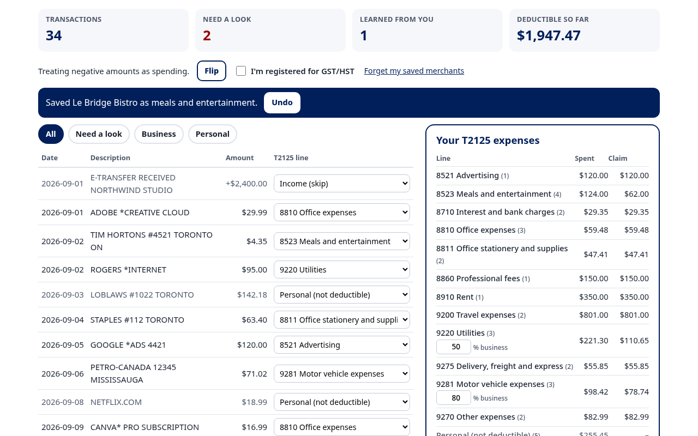

# Shoebox

Sort a year of bank transactions into Form T2125 expense lines without sending them anywhere.

**Live demo:** https://alenzacodes.github.io/shoebox/

A freelancer gets to April with a bank export and no bookkeeping. Shoebox takes that CSV, puts each transaction on a Form T2125 expense line, flags the ones it isn't sure about, and learns from every fix. A small open-weight sentence model does the sorting inside your browser tab, so the statement never leaves your laptop. There's no server, no account and no upload.

## Who would pay for it

The person I have in mind is a sole proprietor with a few hundred business transactions a year who doesn't want to pay a bookkeeper to sort them, and doesn't want to hand a full bank history to a hosted app to save an hour.

The plan, if people use it:

- The app stays free and open source, as it is here.
- A paid version for bookkeepers who get "shoebox" CSVs from sole-proprietor clients who don't use bookkeeping software. QuickBooks and Xero have bank rules, but only once the client's data is in them. Shoebox would give each client their own saved merchant list, map straight to T2125 lines, and keep client statements out of yet another cloud tool. I'm thinking of something like $10 per client per tax year.
- Because inference runs on the user's machine, serving one more customer costs almost nothing. There's no per-call API bill to pass on.

I haven't put it in front of a paying user yet.

## How it works

1. **Read.** `logic.js` parses the CSV and finds the date, description and amount columns. It handles one signed amount column or separate withdrawal and deposit columns, with or without a header row. It shows which sign it's treating as spending, and you can flip it if your card export shows charges as positive numbers.
2. **Embed.** Each description is cleaned (store numbers, reference codes and city names removed) and turned into a 384-number vector by [all-MiniLM-L6-v2](https://huggingface.co/Xenova/all-MiniLM-L6-v2) through [Transformers.js](https://github.com/huggingface/transformers.js). The model files are in [`models/`](models/) and served from the same site, under their Apache 2.0 license.
3. **Match.** Every line in `lines.js` has a few example phrases. A row goes to the line with the closest example. If the best score is low, or the top two lines are close, the row is flagged.
4. **Learn.** A fix becomes a new example for close matches. Other rows from the same merchant move with it, and you can undo the move. The merchant is saved in `localStorage` so it's sorted the same way next time. "Forget my saved merchants" clears that.

Some rules on top of the model:

- Meals and entertainment are generally limited to 50%.
- Utilities (9220) and motor vehicle costs (9281) only count once you enter a business-use percentage. For a vehicle, that should come from your logbook. Until then they're left out of the total and the app says so.
- Card payments, tax instalments, GST/HST remittances, loan payments and transfers to savings go to "Not an expense".
- Money coming in counts as income, unless the description says refund, return or reversal. A refund comes off the merchant's line.
- If you tick "registered for GST/HST", the app warns you that the totals still include GST/HST you may be claiming back as input tax credits.

You get two downloads: `t2125-totals.csv`, with spent, business-use % and claim per line in form order, and `sorted-transactions.csv`, with every row and its line.

## How well it sorts

[`eval/`](eval/) runs the classifier and a plain keyword matcher over `eval/heldout.csv`. That file has 186 transactions with the right line in a fourth column. I wrote the descriptions myself, in the style of real Canadian bank exports, and labelled them myself, after the hint phrases were written. The thresholds weren't changed after seeing the results. Two caveats: the "not an expense" class and its 9 rows were added together, after the rest of the set, and some labels are judgment calls (is a Cineplex charge a client night out or personal?).

| | Right line | Share |
|---|---|---|
| Shoebox, before any fixes | 133 of 186 | 72% |
| Keyword matcher on the same hint phrases | 92 of 186 | 49% |

The keyword matcher had no guess at all for 76 rows, but when it did guess it was right 92 of 110 times (84%). Shoebox flagged 85 rows, and those flags caught 46 of its 53 mistakes, so the 101 rows it didn't flag were right 94 times (93%). The model's real advantage is coverage plus honest flags. In practice you review about half the rows the first time, and fewer after that, because your fixes are saved in the browser.

The 34-row `sample.csv` on the demo is easier. 32 rows land right the first time, and the 3 flagged rows include both mistakes.

## What it won't do

It doesn't know your business. A Staples run could be supplies or a desk, which is a capital purchase. It doesn't work out input tax credits, business-use-of-home or capital cost allowance. Treat it as a first sort that you check, not a tax return.

## Run it

It's a static site. Serve the folder with any web server, for example `python3 -m http.server`, and open it. The first visit downloads the model (about 23 MB) from the `models/` folder and the Transformers.js runtime from cdn.jsdelivr.net. After that the browser keeps a copy. Tests for the parser, classifier and totals run with `node test.js`.

## Contributing

See [CONTRIBUTING.md](CONTRIBUTING.md). Better hint phrases for a line are the easiest place to start, and `eval/` tells you whether they helped.

## Sources

- [CRA, Expenses section of Form T2125](https://www.canada.ca/en/revenue-agency/services/tax/businesses/topics/sole-proprietorships-partnerships/report-business-income-expenses/completing-form-t2125/expenses-section-form-t2125.html), for the line numbers and "enter only the business part".
- [CRA Guide T4002, Chapter 3](https://www.canada.ca/en/revenue-agency/services/forms-publications/publications/t4002/t4002-5.html), for the 50% limit on meals and entertainment, business use of vehicles, and input tax credits.

The sample statement and the held-out set are made up.

## License

MIT. See [LICENSE](LICENSE).
